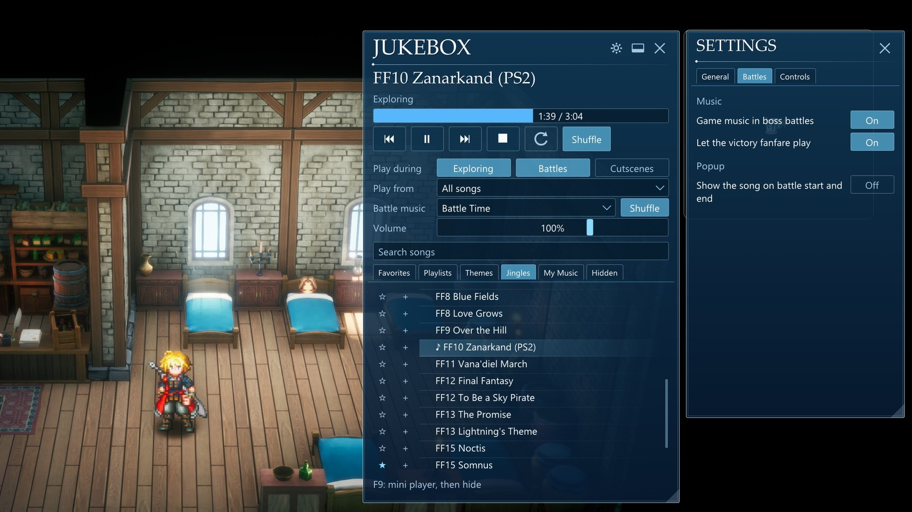
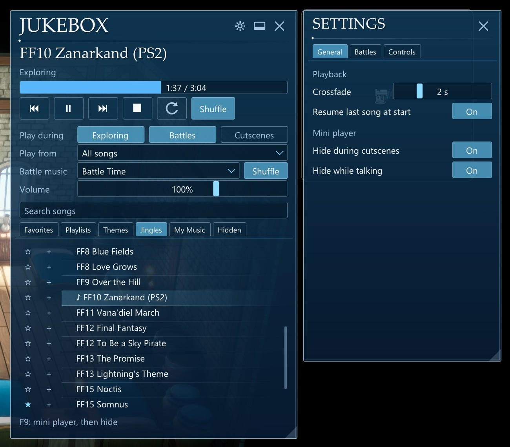
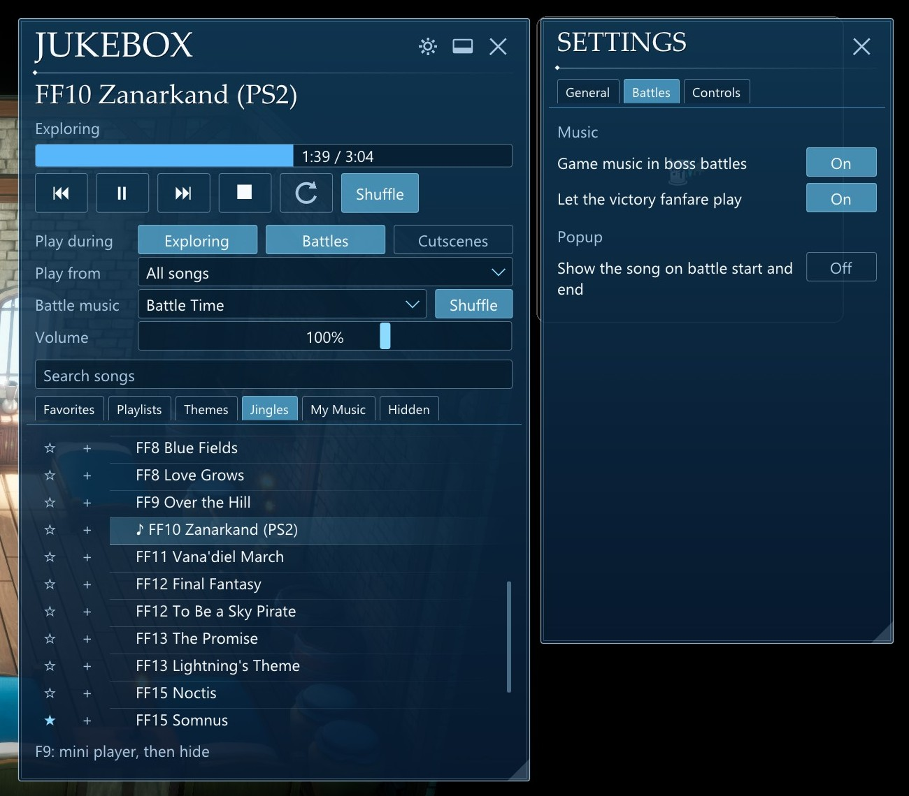
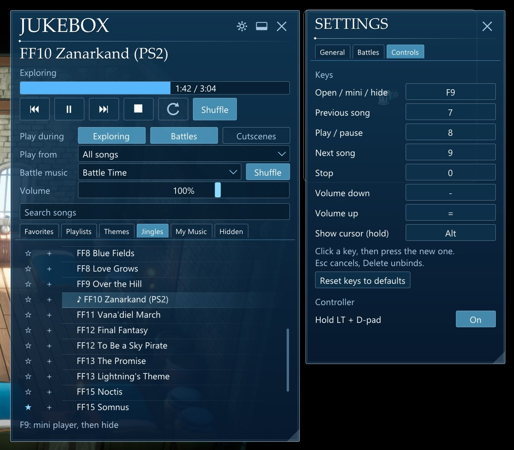
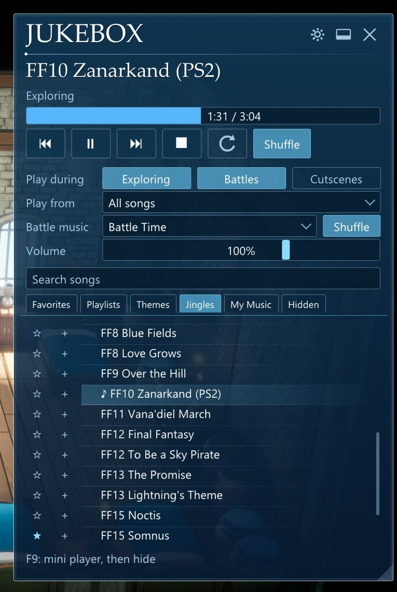
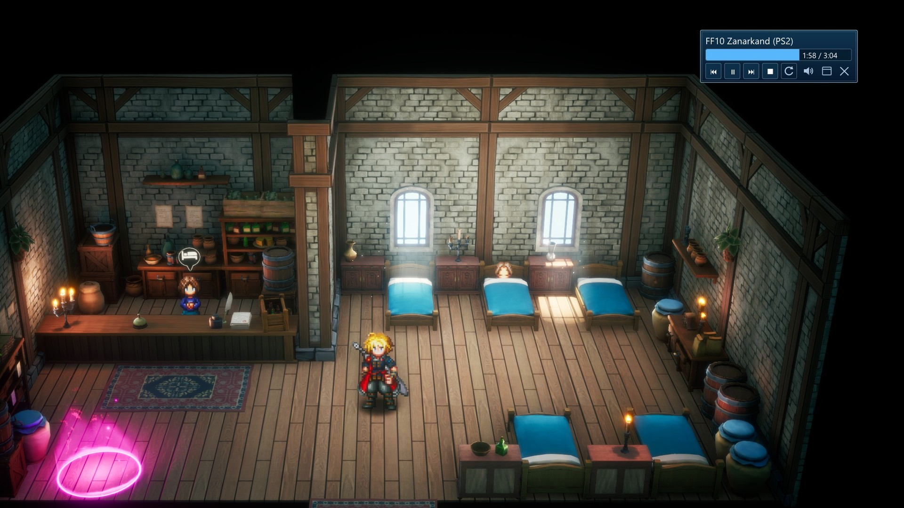

# FF Resonance Jukebox

Play any song you like while you explore FINAL FANTASY RESONANCE: every track in the game, or your own
music. An in-game menu in the game's own style, a mini player, hotkeys and controller combos.

https://github.com/user-attachments/assets/fd076333-e541-4f3c-b841-5f5bd7930dd5

**[Watch it in full quality on YouTube](https://youtu.be/XU42YjN3Cfk)**

## Features

- **Every game song.** All 196 playable songs from the game's soundtrack, with readable names, split into
  looping Themes and short Jingles, including the classics from across the series.
- **Your own music.** Drop mp3, ogg, flac, wav, m4a or aac files into the `jukebox` folder. They are levelled
  automatically to match the game's music and follow the game's own Music and Master volume. Each folder
  inside becomes a playlist.
- **Choose where it plays:** switch Exploring, Battles and Cutscenes on or off, in any mix (Battles alone
  works too). Anywhere it doesn't play, the game's own music comes back.
- **Battle music of your choice.** Pick a separate list for fights; after the battle your exploring song
  picks up where it left off.
- **Victory fanfare.** Winning a battle fades the jukebox out for the game's own fanfare, then picks up
  your exploring song again (a setting, on by default).
- **Boss battles keep their music.** Boss fights play the game's own music, as the developers intended
  (a setting, on by default).
- **Battle popup.** The now-playing popup shows the current song when a battle starts and ends (a setting,
  on by default).
- **Keeps playing while you talk.** Townsfolk, shops, the inn and bulletin boards don't interrupt your
  music; only story scenes count as cutscenes.
- **Favorites, playlists, hide and rename** any song, from a right-click menu.
- **Shuffle without repeats** (battle music has a Shuffle of its own), a one-click **repeat** button (off, playlist, song), **crossfade** between songs, and **resume** the last
  song where you left it when the game starts.
- **Mini player** for while you explore, with volume on the mouse wheel. It can hide itself during
  cutscenes and while talking.
- **Hotkeys and controller combos**, all rebindable.
- Steps aside on its own for pre-rendered movies that carry their own soundtrack.

## Screenshots



| | |
|---|---|
|  |  |
| **General:** crossfade, resume and the mini player | **Battles:** boss music, the victory fanfare and the battle popup |
|  |  |
| **Controls:** rebindable keys and controller combos | **The menu:** every game song, your own music and playlists |



## Requirements

- FINAL FANTASY RESONANCE (Steam, Windows).
- An ASI loader: [Ultimate ASI Loader](https://github.com/ThirteenAG/Ultimate-ASI-Loader) as `winmm.dll`.
  If you already use [PolarWizard's ultrawide fix](https://github.com/PolarWizard/final-fantasy-resonance-fix),
  you have it.

## Install

1. If you don't have an ASI loader yet, put Ultimate ASI Loader's `winmm.dll` in
   `FINAL FANTASY RESONANCE\FFRS\Binaries\Win64\`.
2. Copy `ffrs_jukebox.asi` into `FINAL FANTASY RESONANCE\FFRS\Binaries\Win64\scripts\` (create `scripts` if
   it isn't there).
3. Start the game. The `jukebox` folder for your own music and `ffrs_jukebox.toml` appear next to the `.asi`
   on the first run.

**Uninstall:** delete `ffrs_jukebox.asi`, `ffrs_jukebox.toml`, `ffrs_jukebox.log` and the `jukebox` folder from
`scripts\`.

## Using it

| Key | Does |
|---|---|
| **F9** | Full menu, then mini player, then hidden |
| **7 / 8 / 9 / 0** | Previous / play-pause / next / stop |
| **- / =** | Volume down / up (hold to repeat) |
| **Hold Left Alt** | Show the cursor over the mini player while exploring |
| **Hold LT + D-pad** | ◀ previous, ▶ next, ▲ play/pause, ▼ stop |

Every key can be changed in the menu's ⚙ settings (Controls tab). The General and Battles tabs hold
crossfade length, resume, the mini player, boss music, the victory fanfare and the battle popup. Hotkeys do nothing while you are typing in a text box, and only work while the game is the
active window.

- **Your own songs:** open the My Music tab and press **Open music folder**, add files, then **Rescan folder**.
- **Right-click any song** to add it to a playlist, rename it or hide it. Hidden songs can be brought back
  from the Hidden tab.
- **Play from** picks the list Next and Shuffle draw from; **Battle music** picks a separate one for fights.

## Good to know

- 16 of the game's 212 named songs have no audio in the game's files (some Pixel Remaster and series
  classics). The jukebox checks every song silently once per game version and leaves those out.
- Pre-rendered movies with their own soundtrack (the opening, for one) pause the jukebox; in-engine
  cutscenes are covered by the "Exploring, Battling, and Cutscenes" mode.
- Controller combos can't hide those buttons from the game, so whatever LT and the D-pad do in the game
  still happens.
- If you also use Resonance Boosters, its speed-reset key defaults to F9; move one of the two.
- Single-player only; nothing is sent anywhere.

## Troubleshooting

`ffrs_jukebox.log` next to the `.asi` records what the jukebox does: the songs it found, what played, and
any errors. Settings live in `ffrs_jukebox.toml`; if that file is ever damaged, the old one is kept as
`ffrs_jukebox.toml.bad` before defaults are written.

## Building from source

Needs Rust (stable, MSVC toolchain) on Windows.

```
git clone --recursive https://github.com/Darjjj/ffrs-jukebox
cd ffrs-jukebox
cargo build --release
```

The build is `target\release\ffrs_jukebox.dll`; rename it to `ffrs_jukebox.asi`.

## Credits

- Game SDK (generated with [Dumper-7](https://github.com/Encryqed/Dumper-7)) from
  [PolarWizard's FINAL FANTASY RESONANCE fix](https://github.com/PolarWizard/final-fantasy-resonance-fix), MIT.
- [hudhook](https://github.com/veeenu/hudhook) and [Dear ImGui](https://github.com/ocornut/imgui) for the
  overlay, [rodio](https://github.com/RustAudio/rodio) / [Symphonia](https://github.com/pdeljanov/Symphonia)
  for your own music, [grapnel](https://crates.io/crates/grapnel) for the game hook.
- FINAL FANTASY RESONANCE and its music belong to SQUARE ENIX. This is a fan-made mod, not affiliated with
  or endorsed by Square Enix; it ships no game files.

**AI disclosure:** this mod was built with Claude Code (Anthropic's Claude Opus 5.5), directed and tested in
game by Darjjj.

## License

[MIT](LICENSE)
