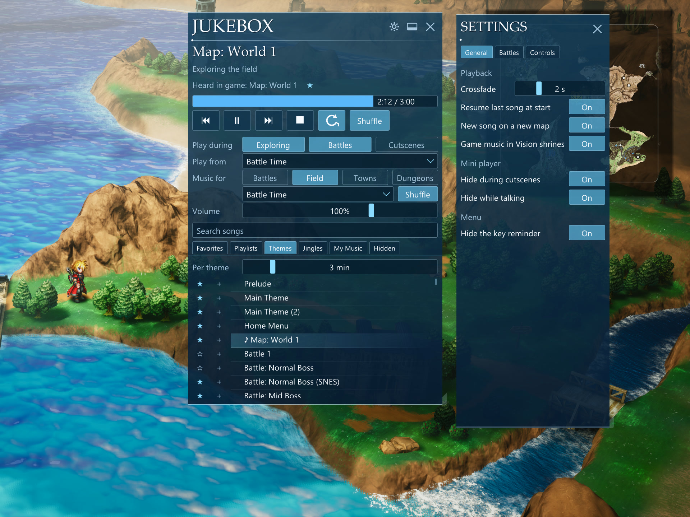
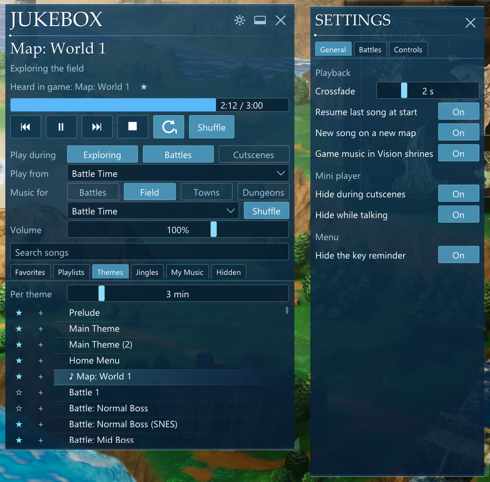
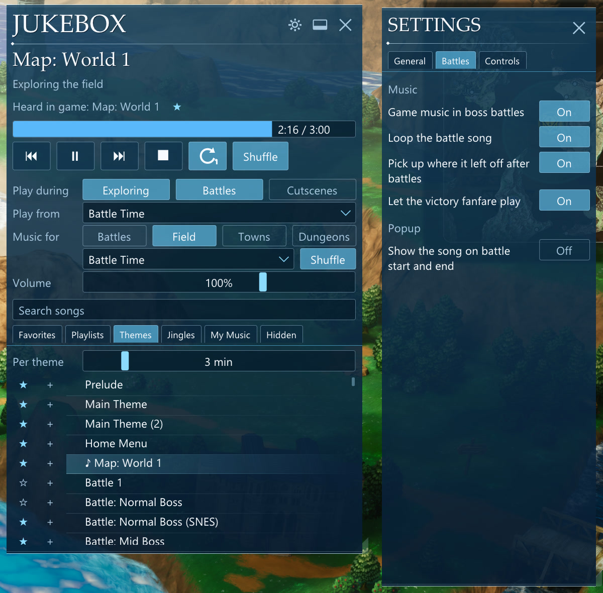
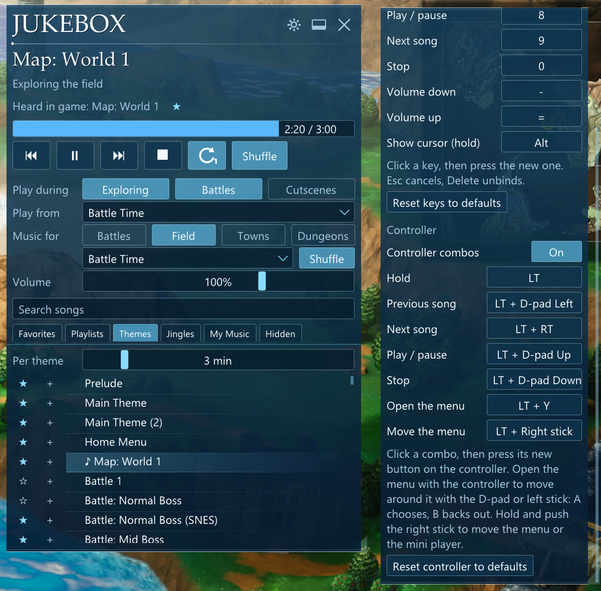
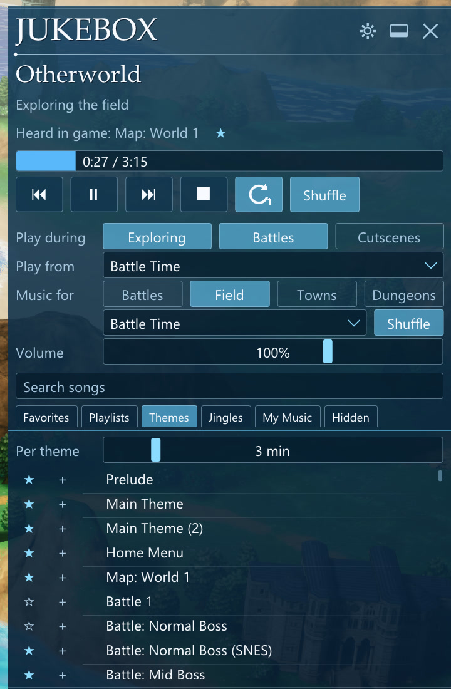
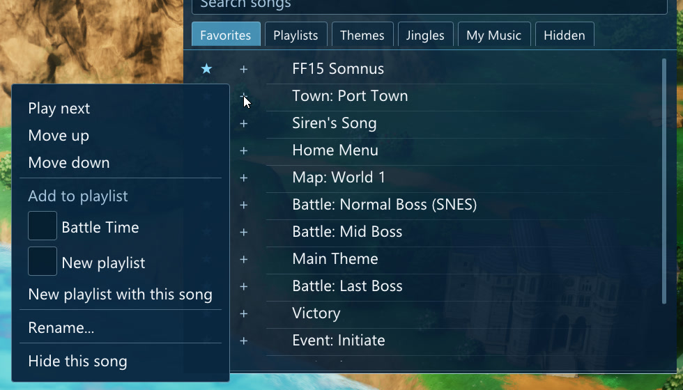
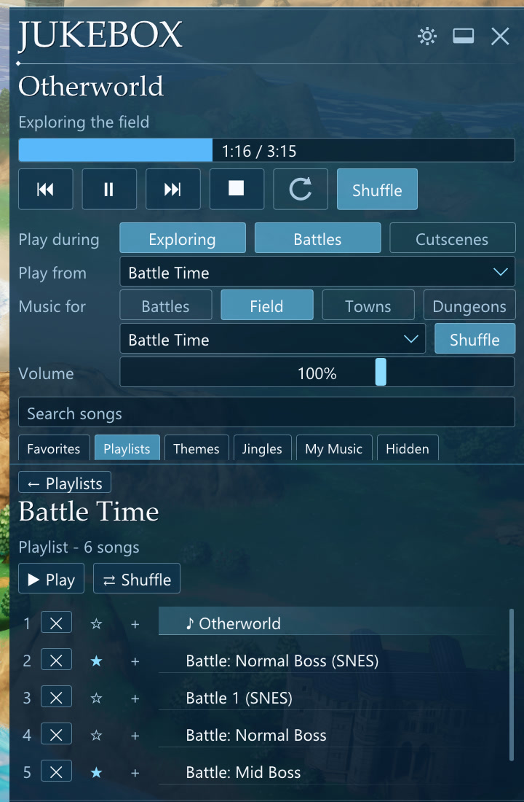
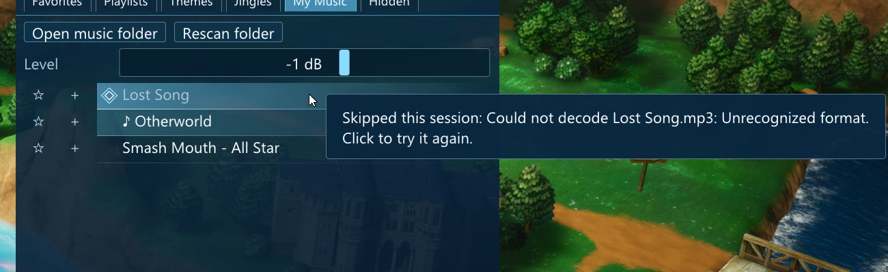
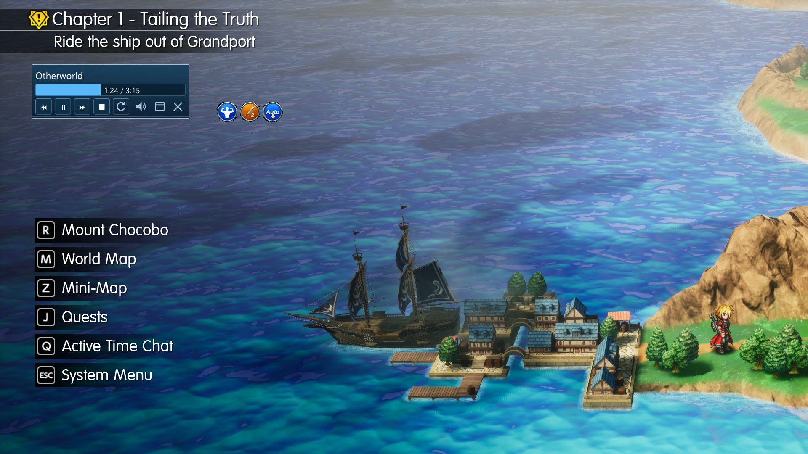
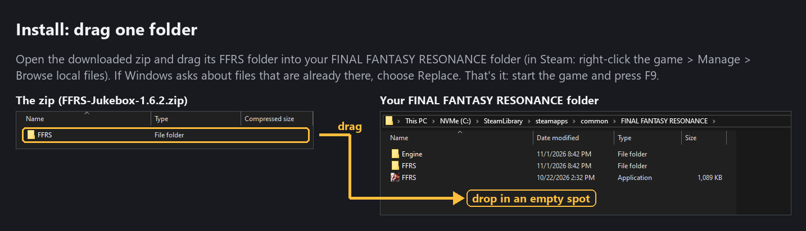

# FF Resonance Jukebox

Play any song you like while you explore FINAL FANTASY RESONANCE: every track in the game, or your own
music. An in-game menu in the game's own style, a mini player, hotkeys and controller combos.

https://github.com/user-attachments/assets/fd076333-e541-4f3c-b841-5f5bd7930dd5

**[Watch the 1.8 showcase in full quality on YouTube](https://youtu.be/pXe2QZpTQeM)**

## Features

- **Every game song.** All 196 playable songs from the game's soundtrack, with readable names, split into
  looping Themes and short Jingles, including the classics from across the series.
- **Your own music.** Drop mp3, ogg, flac, wav, m4a or aac files into the `jukebox` folder. They are levelled
  automatically to match the game's music and follow the game's own Music and Master volume. Each folder
  inside becomes a playlist.
- **Choose where it plays:** switch Exploring, Battles and Cutscenes on or off, in any mix (Battles alone
  works too). Anywhere it doesn't play, the game's own music comes back.
- **Battle music of your choice.** Pick a separate list for fights; after the battle your exploring song
  picks up where it left off. The song a fight starts with can loop until it ends (a setting).
- **Victory fanfare.** Winning a battle fades the jukebox out for the game's own fanfare, then picks up
  your exploring song again (a setting, on by default).
- **Boss battles keep their music.** Boss fights play the game's own music, as the developers intended
  (a setting, on by default).
- **Battle popup.** The now-playing popup shows the current song when a battle starts and ends (a setting,
  on by default).
- **Music by place.** The field, towns and dungeons can each have a list of their own (with its own
  Shuffle), keep the game's own music, or follow Play from. Vision shrines can keep the game's music too.
- **New song on a new map.** Entering a town or another area can move on to the next song (a setting,
  off by default).
- **Keeps playing while you talk.** Townsfolk, shops, the inn, bulletin boards and save points don't interrupt your
  music; only story scenes count as cutscenes.
- **Favorites, playlists, hide and rename** any song, from a right-click menu.
- **Play next** lines up one song to play after the current one, without losing your place in the list.
  **Move up** and **Move down** reorder your lists from a song's + menu, controller included.
- **Shuffle without repeats** (battle music has a Shuffle of its own), a one-click **repeat** button (off, playlist, song), **crossfade** between songs, and **resume** the last
  song where you left it when the game starts.
- **Mini player** for while you explore, with volume on the mouse wheel. It can hide itself during
  cutscenes and while talking.
- **Hotkeys and controller combos**, all rebindable. Open the menu with the controller to drive it with
  the D-pad and A/B, and move it with the right stick; the game doesn't see those presses.
- Steps aside on its own for pre-rendered movies that carry their own soundtrack.

## Screenshots



| | |
|---|---|
|  |  |
| **General:** crossfade, resume, new song on a new map and the mini player | **Battles:** boss music, the victory fanfare, looping and picking up afterwards |
|  |  |
| **Controls:** rebindable keys and controller combos | **The menu:** every game song, your own music and playlists |
|  |  |
| **A song's + menu:** Play next, Move up and Move down, playlists, rename, hide | **A playlist:** Play, Shuffle, and drag or move songs into order |





## Requirements

- FINAL FANTASY RESONANCE (Steam, Windows). Everything else is in the zip, including the ASI loader
  ([Ultimate ASI Loader](https://github.com/ThirteenAG/Ultimate-ASI-Loader)) that loads the jukebox.
- Each jukebox version is made for one build of the game. After a game update, the jukebox stays off and
  its menu says so until a jukebox update for the new build is out. If you'd rather try your luck, set
  `allow_untested_build = true` in `ffrs_jukebox.toml`: the jukebox then runs when the game's code still
  looks the same where it hooks in, with a warning in the menu. It can crash the game on a build that
  changed more than that, so it's off by default.

## Install

Drag the **FFRS** folder from the zip into your `FINAL FANTASY RESONANCE` folder (in Steam: right-click the
game > Manage > Browse local files). If Windows asks about files that are already there, choose **Replace**.
Then start the game and press **F9**.



That puts `winmm.dll` (the ASI loader) in `FFRS\Binaries\Win64\` and the jukebox in
`FFRS\Binaries\Win64\scripts\`. The `jukebox` folder for your own music and `ffrs_jukebox.toml` appear next to
the jukebox on the first run.

**Uninstall:** delete `ffrs_jukebox.asi`, `ffrs_jukebox.toml`, `ffrs_jukebox.log` and the `jukebox` folder (your
own music) from `scripts\`. If no other mod uses the ASI loader, also delete `winmm.dll` and
`Ultimate-ASI-Loader_LICENSE.txt` from `Win64\`; the ultrawide fix needs them.

## Using it

| Key | Does |
|---|---|
| **F9** or **Hold LT + Y** | Full menu, then mini player, then hidden (LT + Y opens it for the controller) |
| **7 / 8 / 9 / 0** | Previous / play-pause / next / stop |
| **- / =** | Volume down / up (hold to repeat) |
| **Hold Left Alt** | Show the cursor over the mini player while exploring |
| **Hold LT + D-pad** | ◀ previous, ▶ next, ▲ play/pause, ▼ stop |
| **Hold LT + right stick** | Move the menu or the mini player |
| **In the menu, by controller** | D-pad or left stick to move, A to choose, B to back out |

Every key can be changed in the menu's ⚙ settings (Controls tab). The General tab holds the crossfade
length, how long looping game themes play, resuming at start, a new song on a new map, Vision shrines,
the mini player and the key reminder; the Battles tab holds boss music, the victory fanfare, looping the
battle song, picking up after battles and the battle popup. Hotkeys do nothing while you are typing in a
text box, and only work while the game is the active window.

- **Your own songs:** open the My Music tab and press **Open music folder**, add files, then **Rescan folder**.
- **Right-click any song** to add it to a playlist, rename it or hide it. Hidden songs can be brought back
  from the Hidden tab.
- **Play from** picks the list Next and Shuffle draw from; **Music for** picks a separate one for battles,
  the field, towns or dungeons. **Game themes** is the game's full-length songs without its short jingles.
- **Heard in game:** the full menu shows the game's own song you heard last, with a star to add it to
  Favorites.
- **Greyed-out songs** wouldn't play earlier this session (hover one to see why). Next and Shuffle pass
  them by; click one to try it again.
- **Controller with extra buttons?** Back paddles, grip buttons and the like (Xbox Elite, DualSense Edge,
  Steam Deck, Steam Controller) can do it in one tap: with Steam Input on for the game (right-click it in
  your Steam library > Properties > Controller), bind a spare button to a jukebox key in the controller
  layout, e.g. **F9** for the menu or **8** for play/pause.

## Good to know

- 16 of the game's 212 named songs have no audio in the game's files (some Pixel Remaster and series
  classics). The jukebox checks every song silently once per game version and leaves those out.
- Pre-rendered movies with their own soundtrack (the opening, for one) pause the jukebox. Movies inside a
  battle (Vision attacks) play over the battle music, so your song carries on through them. In-engine
  cutscenes get your music too if you turn on **Cutscenes** under "Play during".
- While the combo's hold button (LT) is down, the game doesn't see the combo buttons or the right stick;
  LT itself still reaches the game.
- Single-player only; nothing is sent anywhere.

## Troubleshooting

`ffrs_jukebox.log` next to the `.asi` records what the jukebox does: the songs it found, what played, and
any errors. Settings live in `ffrs_jukebox.toml`; edit it with the game closed, since the jukebox writes
it while the game runs. A wrong value in it goes back to its default and the rest is kept (the log says
which); if the file isn't readable as settings at all, it's kept as `ffrs_jukebox.toml.bad` before
defaults are written.

## Building from source

Needs Rust 1.88 or newer (stable, MSVC toolchain) on Windows.

```
git clone --recursive https://github.com/Darjjj/ffrs-jukebox
cd ffrs-jukebox
cargo build --release
```

The build is `target\release\ffrs_jukebox.dll`; rename it to `ffrs_jukebox.asi`.

For a build to give to others, keep your own folders out of its debug paths and let `tools\package.py`
make the zip (it refuses a build that has them, or that's older than the sources):

```powershell
$env:RUSTFLAGS = "--remap-path-prefix=$env:USERPROFILE=~ --remap-path-prefix=$PWD=ffrs-jukebox"
cargo build --release
python tools\package.py
```

## Credits

- Game SDK (generated with [Dumper-7](https://github.com/Encryqed/Dumper-7)) from
  [PolarWizard's FINAL FANTASY RESONANCE fix](https://github.com/PolarWizard/final-fantasy-resonance-fix), MIT.
- [Ultimate ASI Loader](https://github.com/ThirteenAG/Ultimate-ASI-Loader) by ThirteenAG (MIT), included as
  `winmm.dll`; its license is next to it, in `Win64\Ultimate-ASI-Loader_LICENSE.txt`.
- [hudhook](https://github.com/veeenu/hudhook) and [Dear ImGui](https://github.com/ocornut/imgui) for the
  overlay, [rodio](https://github.com/RustAudio/rodio) / [Symphonia](https://github.com/pdeljanov/Symphonia)
  for your own music, [grapnel](https://crates.io/crates/grapnel) for the game hook.
- FINAL FANTASY RESONANCE and its music belong to SQUARE ENIX. This is a fan-made mod, not affiliated with
  or endorsed by Square Enix; it ships no game files.

**AI disclosure:** this mod was built with Claude Code (Anthropic's Claude Opus 5.5), directed and tested in
game by Darjjj.

## License

[MIT](LICENSE)
